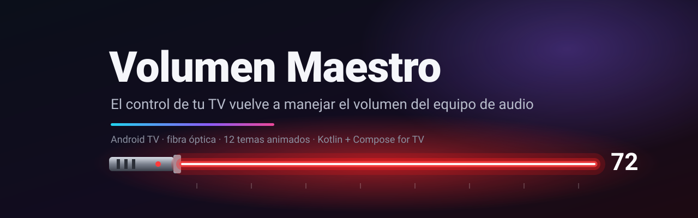
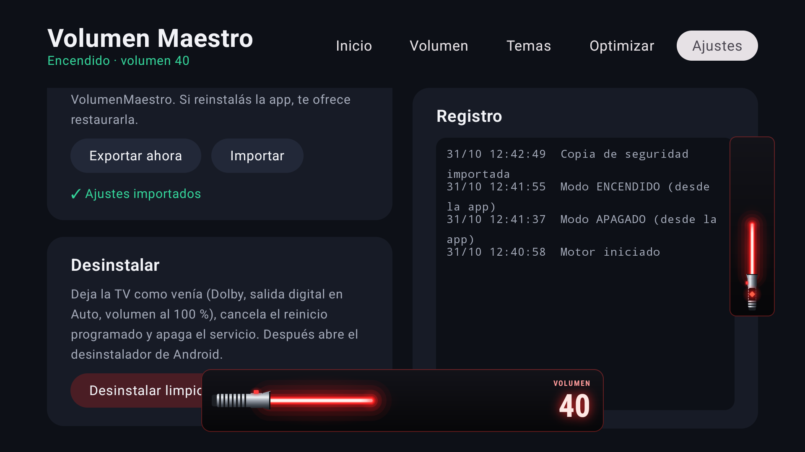
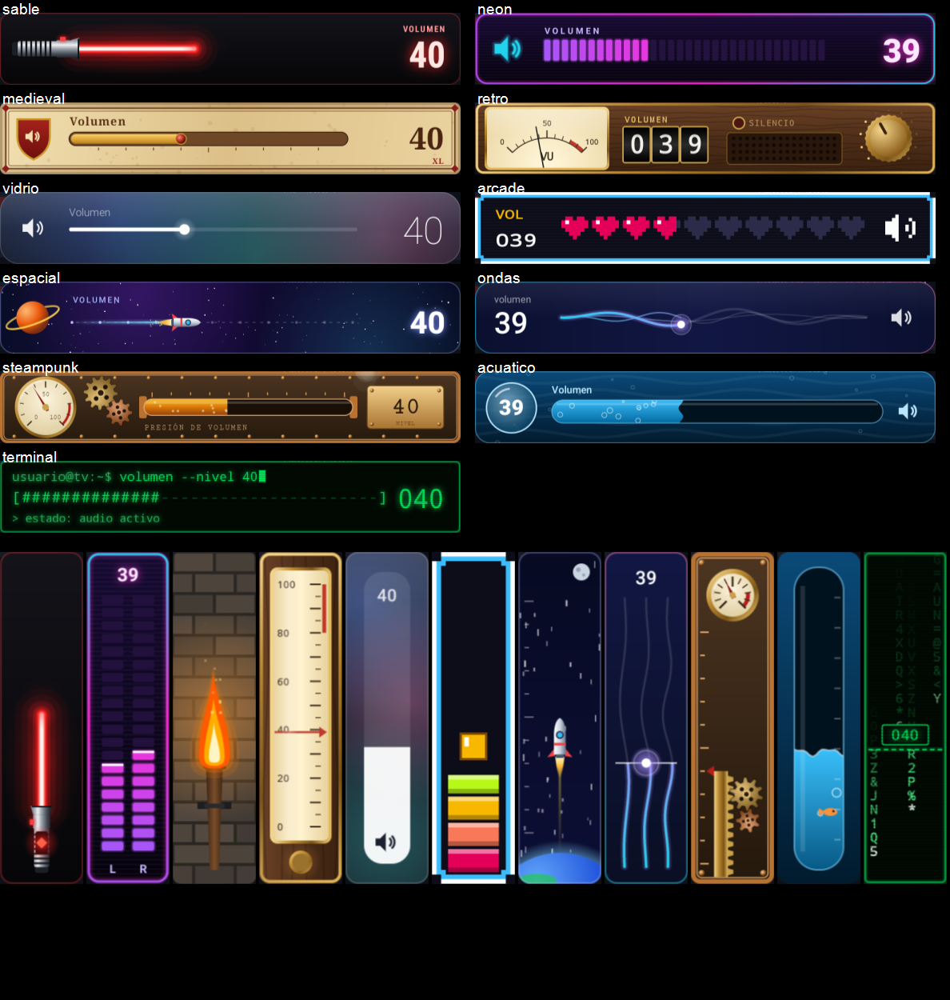
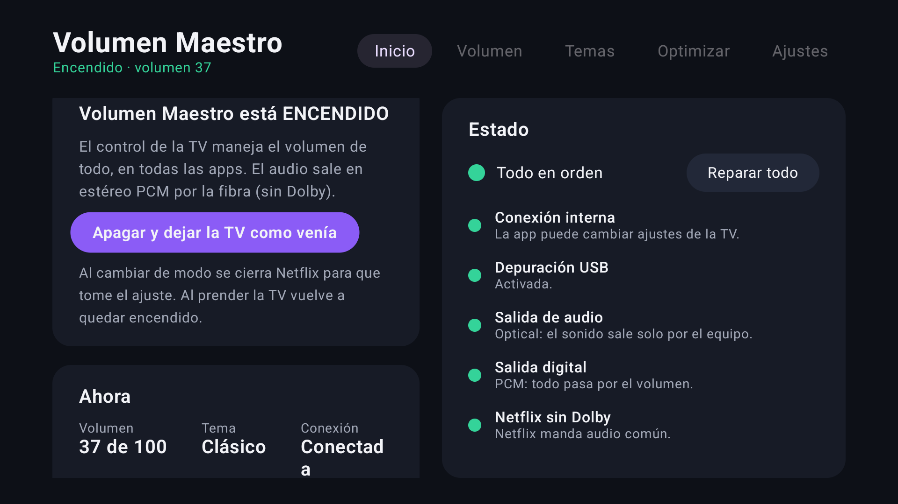
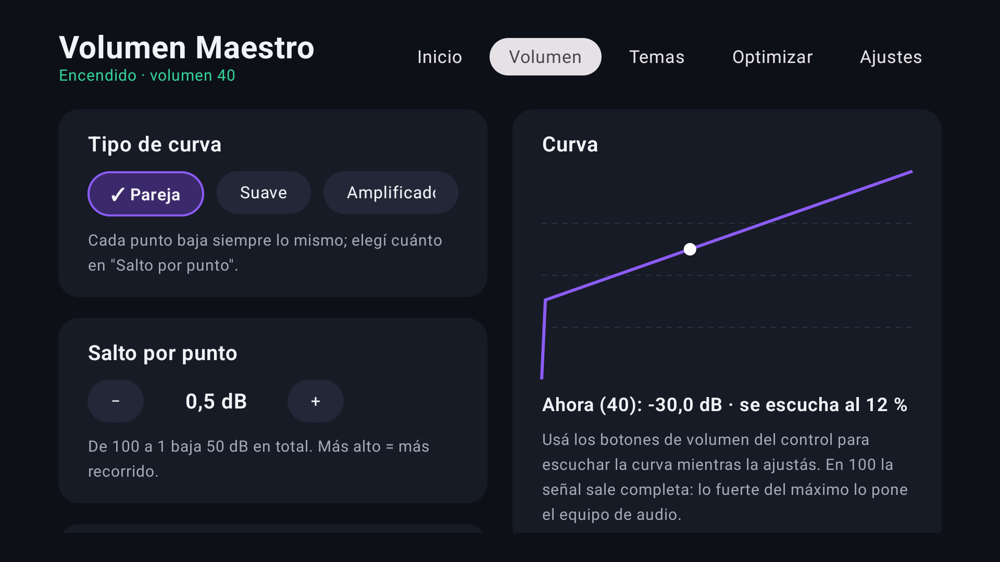
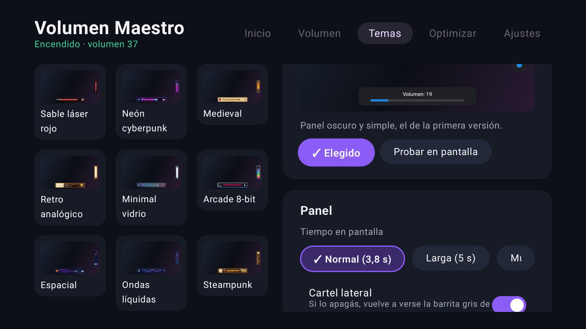
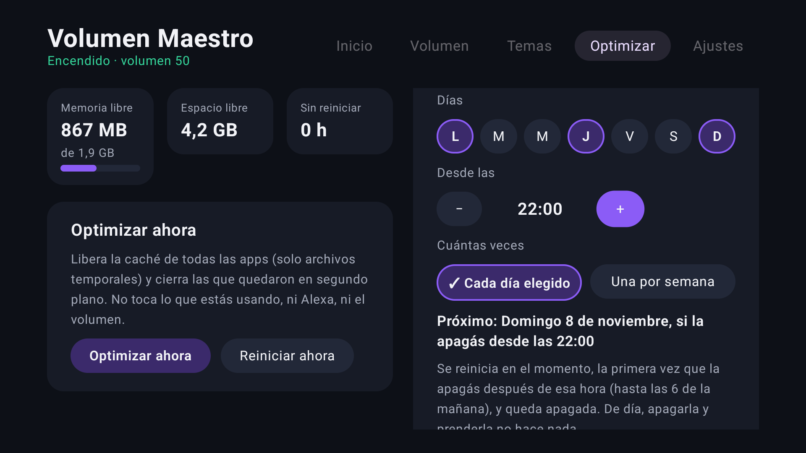

  

  <a href="https://guidocameraeq.github.io/volumen-maestro/"><b>Landing</b></a> ·
  <a href="https://guidocameraeq.github.io/volumen-maestro/mockups/temas.html"><b>Probá los temas en vivo</b></a> ·
  <a href="https://guidocameraeq.github.io/volumen-maestro/mockups/temas-spooky.html">Noche de brujas</a> ·
  <a href="docs/arquitectura.md">Arquitectura</a> ·
  <a href="docs/audio-dolby.md">La historia del audio</a> ·
  <a href="docs/temas.md">Crear un tema</a>

---

## ¿Qué es?

**Volumen Maestro** es una app para **Android TV / Google TV** que resuelve un problema muy concreto: tenés un equipo de audio conectado a la TV por **fibra óptica**, la TV deja esa salida a **volumen fijo** y el control de la TV ya no sirve para subir o bajar el sonido. Te muestra un cartel de *"optical does not support volume adjustment"* y tenés que usar el control del equipo de audio.

Volumen Maestro devuelve el control: los botones de volumen de la TV pasan a manejar una **capa de volumen por software**, la última antes de la salida (el "volumen maestro" de Android). El equipo queda fijo en un volumen alto y todo se maneja desde la TV, como hacía un Chromecast. Además tapa el cartel de la TV con **carteles animados con temas** y trae herramientas para que una TV de 2 GB ande más liviana.

> Está hecha y probada en **una** TV: TCL Google TV (Android TV 12, chip Amlogic) con un receptor Sony STR-KG700. En otras TV puede necesitar ajustes (ver [Compatibilidad](#compatibilidad)).

## Cómo se ve

  

   
  Los 11 temas, capturados en la TV real: panel inferior arriba y cartel lateral abajo.

| Inicio | Volumen | Temas | Optimizar |
|---|---|---|---|
|  |  |  |  |

## Qué hace

- 🔊 **Volumen con el control de la TV** en todas las apps (YouTube, Netflix, Spotify…), aunque la salida óptica sea de volumen fijo. También responde a Alexa.
- 🔀 **Interruptor ENCENDIDO / APAGADO**: encendida, todo sale en PCM y el control maneja el volumen; apagada, la TV queda como venía (Dolby al equipo). Al prender la TV vuelve sola a ENCENDIDO.
- 📈 **Curva de volumen configurable**: *Pareja* (elegís cuántos dB baja cada punto), *Suave* o *Ampli*, con gráfico en vivo.
- ⚔️ **15 temas animados** para los carteles, en 4 grupos: *Sobrios* (Clásico, Minimal vidrio, Ondas líquidas, Retro analógico), *Fantasía* (Medieval, Espacial, Acuático, Steampunk, Sable láser rojo), *Gamer y tecno* (Neón cyberpunk, Arcade 8-bit, Terminal hacker) y *Noche de brujas* (Colina espiral, Candelabro gótico, Hilo de seda).
- 🔀 **Botón TCL Home como "Alt-Tab"**: un toque abre las apps abiertas (con vista previa), dos toques vuelven a la app anterior. "Limpiar todo" las cierra.
- 🩺 **Estado tipo semáforo** con "Reparar todo" por si una actualización de la TV desacomoda algo.
- 🧹 **Optimizar**: libera caché, cierra apps de fondo, muestra memoria, espacio y tiempo encendida.
- 🔁 **Reinicio al apagar**: en los días que elijas, la primera vez que apagás la TV desde cierta hora de la noche se reinicia y queda apagada. De día no hace nada.
- 🎮 **Atajo del control**: un botón que no usás (por ejemplo Info) prende o apaga la app.
- 💾 **Copia de seguridad** automática y **desinstalación limpia** (deja la TV como venía).

## Cómo funciona (corto)

1. TCL procesa los botones de volumen y, aunque diga "no soportado", **guarda el número de volumen**.
2. La app escucha ese número y lo traduce, con tu curva, al **volumen maestro de Android** (AudioFlinger), que se aplica a todo el audio PCM, también al modo "túnel" que usa Netflix.
3. Cambiar el volumen maestro requiere permisos de sistema: la app se conecta al **ADB de la propia TV** (127.0.0.1:5555) con su propia clave, autorizada una vez.
4. Si la TV engancha sus efectos de sonido a la mezcla (TCL lo hace al prender), Android redondea el volumen maestro a 0 o 1; un **ecualizador plano** de Android se hace cargo del volumen y lo evita.
5. Dos ventanas opacas tapan los carteles de TCL con el tema que elegiste.

El por qué de cada pieza está en [`docs/decisiones.md`](docs/decisiones.md), y la investigación completa del audio, con lo que **no** funcionó, en [`docs/audio-dolby.md`](docs/audio-dolby.md).

### El precio: sin Dolby

Con el Dolby, el sonido viaja **comprimido** hasta el equipo y ninguna capa de software lo puede bajar. Por eso el modo ENCENDIDO hace que todo salga en **PCM estéreo**. Si querés sonido envolvente para una película, apagá la app (o usá el atajo) y manejá el volumen con el control del equipo.

## Instalación

Necesitás una PC con `adb` y la TV con la **depuración USB** activada.

1. En la TV: Settings → System → About → apretá 7 veces "Android TV OS build". Después, Settings → System → Developer options → **USB debugging**.
2. Descargá el APK de [Releases](https://github.com/guidocameraeq/volumen-maestro/releases) o compilalo (ver [`docs/desarrollo.md`](docs/desarrollo.md)).
3. `adb connect <IP-de-la-TV>:5555` y `adb install volumen-maestro.apk`.
4. Activá el servicio: Settings → System → Accessibility → **Volumen Maestro**.
5. En la TV aparece *"Allow USB debugging?"*: marcá *Always allow* y aceptá. Es la app pidiendo su conexión interna.
6. Settings → Display & Sound → Audio Output Settings → **Audio Output: Optical**.
7. Subí el equipo de audio a un volumen alto fijo (alrededor del 70-80 % de su escala) y manejá todo con el control de la TV.

**La depuración USB tiene que quedar activada**: la app la usa desde adentro de la TV.

## Uso

Abrí **Volumen Maestro** desde "Your apps":

| Pestaña | Para qué |
|---|---|
| **Inicio** | Prender/apagar, ver el estado y "Reparar todo" |
| **Volumen** | Tipo de curva, dB por punto, volumen 0, transición |
| **Temas** | Elegir el tema (por grupos), probarlo en pantalla, duración y cartel lateral |
| **Optimizar** | Optimizar ahora, reiniciar, reinicio al apagar |
| **Ajustes** | Atajo del control, botón TCL Home, copia de seguridad, registro, desinstalar |

## Compatibilidad

| Probado | Notas |
|---|---|
| ✅ TCL Smart TV Pro (G09), Google TV, Android TV 12, Amlogic | La TV para la que se hizo |
| ⚠️ Otras TCL con Android TV 12 | Probablemente sí; los carteles están ubicados para la interfaz de TCL a 1920×1080 |
| ❓ Otras marcas o versiones de Android | Los códigos de AudioFlinger (7/9) son de Android 12 y cambian entre versiones; los ajustes `tcl_*` son de TCL |

## Para desarrolladores

- [`docs/arquitectura.md`](docs/arquitectura.md): procesos, motor, protocolo y flujo de un toque de volumen.
- [`docs/temas.md`](docs/temas.md): el contrato de los temas y cómo agregar uno nuevo.
- [`docs/desarrollo.md`](docs/desarrollo.md): entorno, compilar, firmar, instalar, depurar.
- [`docs/recientes.md`](docs/recientes.md): el panel de apps abiertas (botón TCL Home).
- [`docs/decisiones.md`](docs/decisiones.md): las decisiones de diseño (ADR).
- [`docs/specs/`](docs/specs/): las especificaciones aprobadas.
- [`docs/tv-guido-tcl/`](docs/tv-guido-tcl/): la historia completa de la TV para la que se hizo (limpieza, Alexa, audio) y cómo restaurar lo que se cambió.

Stack: Kotlin, Jetpack Compose for TV, Gradle 8.7, minSdk 28 / target 34. Sin librerías de terceros para lo crítico (el cliente ADB es propio).

## Créditos

Hecho por [@guidocameraeq](https://github.com/guidocameraeq) con [Claude Code](https://claude.com/claude-code). El tema "Sable láser rojo" es un diseño genérico, sin relación con ninguna franquicia.

Licencia [MIT](LICENSE).
