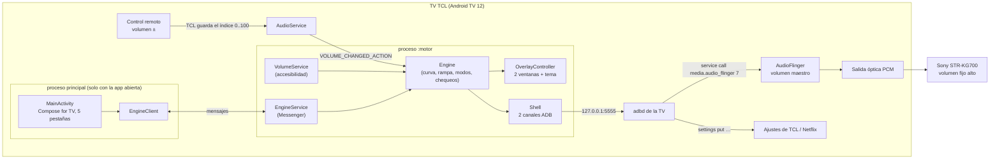

# Arquitectura de Volumen Maestro

## En una imagen

## Las piezas

| Pieza | Archivo | Qué hace |
|---|---|---|
| Servicio de accesibilidad | `VolumeService.kt` | Android lo arranca con la TV. Le da al motor ventanas encima de todo (`TYPE_ACCESSIBILITY_OVERLAY`) y las teclas del control (para el atajo). Mantiene el nombre de la v1 |
| Motor | `engine/Engine.kt` | Singleton del proceso `:motor`. Escucha el volumen, aplica la curva, maneja los modos, los chequeos, el atajo, el reinicio y la copia |
| Shell | `engine/Shell.kt` + `AdbClient.java` + `AdbKeys.java` | Cliente ADB mínimo propio contra el adbd de la TV, con su clave RSA. Dos canales: `volume` (rápido) y `commands` (tareas largas) |
| Volumen maestro | `audio/MasterVolume.kt` | Hilo propio que manda `setMasterVolume` con rampa en dB (pasos de 25 ms) y lo lee para el watchdog |
| Curva | `audio/VolumeCurve.kt` | Índice → ganancia: Pareja (dB por punto), Suave (cuadrática), Ampli (curva en S de −60 dB). En 100 siempre 1.0 |
| Modos | `audio/AudioSetup.kt` | Los ajustes de ENCENDIDO y APAGADO (tabla en `tv-guido-tcl/README.md`) |
| Carteles | `overlay/OverlayController.kt` | Las 2 ventanas (inferior 960×150 en x480/y882; lateral 108×430 en x1740/y326), animación de entrada/salida, solo anima mientras se ven |
| Temas | `overlay/Theme.kt`, `overlay/themes/*` | Interfaz `Theme` + registro. Ver `temas.md` |
| Ajustes | `settings/Config.kt`, `ConfigStore.kt` | `Config` (JSON), guardado en el proceso motor + copia en `/sdcard/VolumenMaestro/ajustes.json` |
| Optimizar | `system/Optimizer.kt` | Estado (memoria, espacio, tiempo encendida), `pm trim-caches`, `am kill-all` |
| Reinicio | `system/RebootScheduler.kt`, `RebootReceiver.kt` | Cálculo del próximo reinicio (probado), alarmas, espera si la TV está en uso |
| Puente | `engine/EngineService.kt`, `engine/Protocol.kt` | Messenger: la interfaz pide, el motor responde con un `Bundle` de estado |
| Interfaz | `ui/*` | Compose for TV: Inicio, Volumen, Temas, Optimizar, Ajustes. `EngineClient` pregunta el estado cada 1 s |

## Flujo de un toque de volumen

1. El control manda volumen −. TCL lo procesa (y muestra su cartel), y baja el índice de la salida óptica.
2. Android emite `VOLUME_CHANGED_ACTION` (STREAM_MUSIC). `Engine.onTvVolumeChanged` lo recibe.
3. `OverlayController.showVolume` muestra los dos carteles del tema elegido, que tapan los de TCL durante 3,8 s.
4. `VolumeCurve.gain` calcula la ganancia y `MasterVolume.setTarget` la manda con la transición elegida.
5. Cada 10 s el watchdog lee el volumen maestro real y lo reaplica si algo lo cambió. Al prender la pantalla también.

## Arranque

`VolumeService.onServiceConnected` → `Engine.start`: carga la config, crea las ventanas, registra los receptores y en el hilo de comandos: carga o crea la clave ADB, busca la copia de seguridad si es la primera vez, se concede el permiso de alarmas, comprueba que el volumen maestro responde, atiende la marca del reinicio programado, reafirma los ajustes del modo ENCENDIDO y programa el próximo reinicio. **Al prender la TV siempre queda ENCENDIDO.**

## Protocolo interfaz ↔ motor

Mensajes en `Protocol.kt`: `GET_STATE`, `SET_ENABLED`, `SET_CONFIG`, `REPAIR_ALL`, `FIX`, `OPTIMIZE`, `GET_STATS`, `REBOOT_NOW`, `PREVIEW_THEME`, `START_LEARN`/`STOP_LEARN` (atajo), `RESTORE_BACKUP`/`DISMISS_BACKUP`, `EXPORT_BACKUP`/`IMPORT_BACKUP`, `PREPARE_UNINSTALL`, `GET_LOG`. Los lentos corren en `Engine.commands` y responden al terminar.

## Atajo del control

El servicio de accesibilidad pide filtrar teclas. Con "Elegir botón" el motor captura la próxima tecla permitida (no flechas, OK, Atrás, Home, Encendido ni volumen). En "Mantener 2 s", un toque corto se reenvía con `input keyevent` (las teclas inyectadas no vuelven a pasar por el filtro), así el botón conserva su función.

## Pruebas

`app/src/test`: curvas (`VolumeCurveTest`), próximo reinicio (`RebootSchedulerTest`), JSON de la config y lectura del float de AudioFlinger (`ConfigTest`). Lo demás se verifica en la TV (ver `/instalar` y `desarrollo.md`).
